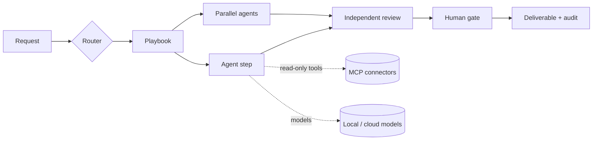

# Productivity Suite

A platform-agnostic application that turns a library of specialist agents into governed, repeatable workflows for professionals: daily planning, decisions, management, product development, engineering and investment cases.

One front door routes each request to a **playbook**: a fixed sequence of steps in which specialist agents work in order or in parallel. A different agent reviews the work, and anything that would leave the app waits for a named person. Agents can run on local models (Ollama, LM Studio, vLLM), OpenAI-compatible clouds (OpenAI, DeepSeek, OpenRouter) and Anthropic, mixed in one run. They read live context through read-only MCP connectors (GitHub, Microsoft 365, Databricks, Azure DevOps, Jira/Confluence, local files).

> Status: MVP. Eight playbooks plus Quick Ask, with 34 agents in 8 desks. Runs in the browser, as a desktop app, and fully offline with local models. See [docs/PLAN.md](docs/PLAN.md) for the plan, decisions and roadmap.

## Quick start

Requirements: Python 3.12+ with [uv](https://docs.astral.sh/uv/), Node 20+. Docker or `npx` only if you enable connectors that use them.

```bash
./scripts/dev.sh
```

Then open http://127.0.0.1:8765. To run it as a desktop app, offline, or from a phone on your network, see [docs/DESKTOP.md](docs/DESKTOP.md). With no model configured, the suite runs in **demo mode**: every step works end to end, but output is labelled demo content. Configure a provider (below) to get real analysis.

For UI development with hot reload:

```bash
cd backend && uv sync && uv run uvicorn app.main:app --port 8765
```

```bash
cd frontend && npm install && npm run dev
```

## Configure models

Copy `config/suite.example.yaml` to `config/suite.yaml`. Credentials are never stored in files; each provider names an environment variable.

| Provider | Where | Enable |
|---|---|---|
| Ollama | local | Set `enabled: true`. Set Ollama's context length (`OLLAMA_CONTEXT_LENGTH` or `num_ctx`) and match `context_tokens`. |
| LM Studio, vLLM | local | Set `enabled: true`. Use the model id the server shows. |
| OpenAI, DeepSeek, OpenRouter | cloud | Export `OPENAI_API_KEY`, `DEEPSEEK_API_KEY` or `OPENROUTER_API_KEY`. Add the models you use under `models:`. |
| Anthropic | cloud | Export `ANTHROPIC_API_KEY`. |

Each **tier** (`router`, `specialist`, `synthesis`, `review`) is an ordered fallback chain. The first model that is available *and* allowed for the run's data class is used. If it errors or declines, the next one is tried. You can override chains per agent (`agent_overrides`) or per playbook step (`models:`).

**Offline mode** (`offline: true` or `SUITE_OFFLINE=1`) switches off every cloud provider and every connector that needs the internet.

**Data classes.** Each run is tagged `public`, `internal`, `confidential` or `restricted`, and `data_classes` decides which provider localities may receive it. By default, `restricted` runs only reach local models. You are responsible for the credentials and data you use; this policy is how you keep sensitive work local.

Settings → Model providers shows availability and has a **Test** button per provider.

## Connectors (MCP, read-only)

Copy `config/connectors.example.yaml` to `config/connectors.yaml` to customise. A connector becomes available when the environment variables it references are set. Setup notes and what to verify are in [docs/CONNECTORS.md](docs/CONNECTORS.md).

**Read-only is enforced by the suite, not only by the server.** An agent is offered a tool only if it is allow-listed, declares `read_only_hint`, or is named like a query (`get_`, `list_`, `search_` and similar) with no write verb. Everything else is hidden and refused, and every call is audited.

## Playbooks

| Code | Playbook | Pattern |
|---|---|---|
| PB-00 | Ask the Chief of Staff | single agent |
| PB-01 | Daily Plan & Priorities | pipeline |
| PB-03 | Pressure-Tested Decision Brief | fan-out → independent challenge → memo |
| PB-04 | Audience Status Update | pipeline + evidence check + human gate |
| PB-05 | Scope-Change Triage | fan-out → synthesis → review (revise on fail) → gate |
| PB-08 | Opportunity to PRD and Feature Slices | pipeline + fan-out + review |
| PB-10 | Architecture Review & ADR | options → security/ops/QA reviews → ADR → review → gate |
| PB-13 | Investment Case | fan-out → synthesis → review → gate |
| PB-15 | Well Plan Review (safety-critical) | deterministic calculators → engineering review → NPT ∥ field challenge → review → engineer sign-off |

Playbooks are YAML in `playbooks/`; the schema is in `backend/app/playbooks.py`. They are validated at startup, and a reviewer can never review its own agent's work.

## How it works



- **Agents.** `scripts/ingest_agents.py` compiles the original agent configurations (`Productivity-Agents-Configs.zip`) into `registry/`. It strips platform-specific content, branding and personal references, merges duplicate roles, and moves persona voice into a separate layer. See `registry/INGEST_REPORT.md`.
- **Contract.** Every agent returns Markdown plus a JSON handoff: status, claims labelled FACT / ASSUMPTION / INFERENCE with traces, risks, open questions and next action. A FACT without a trace is downgraded to ASSUMPTION.
- **Guardrails.** Pasted text, files and tool results are wrapped as untrusted data and screened for injection attempts. The suite has no send/write/publish capability. Deliverables are screened for language that evaluates people. Runs have cost and token budgets, a per-step tool-call limit and a global kill switch. The audit log redacts secrets.
- **Deterministic tools.** The well-planning calculators (casing, hydraulics, torque and drag, risk matrix) run as tested Python functions, so a model never produces those numbers. In Well Plan Review they run first from the JSON you enter, and the engineering agent must cite their results. Output is marked planning-grade and needs a qualified engineer's sign-off.

## Tests and evals

```bash
cd backend && uv run pytest
```

```bash
cd backend && uv run python ../scripts/run_evals.py
```

The first runs 48 tests: engine, providers (mocked HTTP), MCP over stdio, API, guards, calculators and registry. The second runs `evals/cases.yaml` against your configured models and writes a report with a column for your grade.

## Project layout

```
backend/app/        engine, providers, connectors, prompts, guards, store, API
backend/tests/      pytest suite (no network or model needed)
frontend/           React UI (built into frontend/dist, served by the backend)
desktop/            desktop launcher and PyInstaller spec
registry/           compiled agents, skills, desks (generated; do not edit by hand)
playbooks/          workflow definitions
config/             example config, output policies, profile
evals/              benchmark cases
scripts/            ingest, evals, dev server
docs/               plan, connector setup, ADRs
```

## Security notes

- The server binds to `127.0.0.1`. If you expose it, set `SUITE_API_TOKEN`; every API call then needs `Authorization: Bearer <token>`.
- Prompts are not stored by default (`store_prompts: false` keeps only a hash and size).
- Company branding is not in the repository. To theme exports privately, set `theme_dir` to a folder containing `theme.css`.
