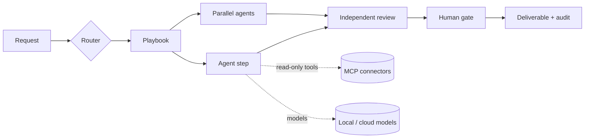

# Agentic Productivity Suite

A platform-agnostic application that turns a library of specialist agents into governed, repeatable workflows for professionals: daily planning, decisions, management, product development, engineering and investment cases.

Two front doors. **Chat** with the Chief of Staff, who answers or brings in up to three specialists, or with any single agent, for anything. Or route a request to a **playbook**: a fixed sequence of steps in which specialist agents work in order or in parallel. A different agent reviews the work, and anything that would leave the app waits for a named person. Agents can run on local models (Ollama, LM Studio, vLLM), OpenAI-compatible clouds (OpenAI, DeepSeek, OpenRouter) and Anthropic, mixed in one run. They read live context through read-only MCP connectors (GitHub, Microsoft 365, Google Workspace, Databricks, Azure DevOps, Jira/Confluence, local files). Connectors need nothing else installed: no terminal, no Docker, no Node.js or uv to set up. Microsoft 365 and Google Workspace sign in with a button in Settings.

> Status: MVP. 19 playbooks (PB-00 to PB-18) and direct chat, with 34 agents in 8 desks. Everything day to day is set up in the app's Settings. Runs in the browser, as a desktop app, and fully offline with local models. See [docs/SAFETY.md](docs/SAFETY.md) for the risk controls and [docs/adr/](docs/adr/) for the design decisions.

**Safe defaults on a fresh install:** every connector is off until you set it up and switch it on; spending limits are off until you switch them on (the guardrails against runaway loops are always on); restricted data only reaches local models; and readable copies of your work are saved to `Documents/Agentic-Suite-Outputs`.

## Quick start

Requirements: none for the installers. Running from the source code needs Python 3.12+ with [uv](https://docs.astral.sh/uv/) and Node 20+ to build the UI. What connectors run (uv, Node.js, GitHub's server program) comes from the computer when it has a recent copy, or is downloaded by the installer, or on first use (see [Connectors](#connectors-mcp-read-only)).

```bash
./scripts/dev.sh
```

Then open http://127.0.0.1:8765. Windows (`.msi`) and Linux (`.deb`) installers are built by GitHub Actions on every pull request and published as a GitHub Release automatically when a merge to `main` raises the version; see [docs/DESKTOP.md](docs/DESKTOP.md) for downloads, releases, offline use and phones. To update, install the new file over the old one; you never need to uninstall first, and your settings and history are kept. The suite needs at least one model: until one is switched on, agent steps stop as BLOCKED with "No model configured" (deterministic calculators still run). Set one up in Settings (below).

For UI development with hot reload:

```bash
cd backend && uv sync && uv run uvicorn app.main:app --port 8765
```

```bash
cd frontend && npm install && npm run dev
```

## Configure models

**From the app (simplest):** Settings → Model providers. Each provider has an **On/Off** switch and an **Edit** panel for its address, API key and models (**Find models** asks the server which models it has). Changes are saved on this computer and apply immediately; **Reset to file defaults** undoes them. A provider switched on here is also used as a fallback by every tier. For LM Studio, start the server, load a model, and if you switched on its authentication, paste its API key in Edit.

**From files:** copy `config/suite.example.yaml` to `config/suite.yaml` (the desktop app uses `~/.productivity-suite/suite.yaml`); it sets the defaults the app starts from. Files never hold credentials: each provider names an environment variable. A key typed into the app is stored unencrypted in the suite's local database and never returned by the API; prefer environment variables for cloud keys.

| Provider | Where | Enable |
|---|---|---|
| Ollama | local | Switch on (or `enabled: true`). Set Ollama's context length (`OLLAMA_CONTEXT_LENGTH` or `num_ctx`) and match the model's context in Edit. |
| LM Studio, vLLM | local | Switch on, then Edit → Find models and pick the loaded model. Add the API key if the server requires one. |
| OpenAI, DeepSeek, OpenRouter | cloud | Edit → API key, or export `OPENAI_API_KEY`, `DEEPSEEK_API_KEY` or `OPENROUTER_API_KEY`. Add the models you use. |
| Anthropic | cloud | Edit → API key, or export `ANTHROPIC_API_KEY`. |

**Which model is used.** Settings → Models → **Models in use** sets a **default model** and a **fallback model**, chosen from every provider that is switched on, local or cloud. Every kind of work tries the default first and the fallback next. The card shows the model each kind of work uses right now, and each model in the provider list is labelled Default, Fallback, In use or Not used.

**A model per agent, to save tokens and cost.** Settings → Models → **Model per agent** lists every agent by desk with what it does, whether its work is reasoning-heavy (combining results, reviewing others' work, safety-critical) or everyday, and the model it uses now. Give each agent its own model, or use **Quick assign** to put a stronger model on the reasoning-heavy agents and a smaller or local one on the everyday agents. An agent's own model goes first; the default and fallback stay behind it.

Behind these, each **tier** (`router`, `specialist`, `synthesis`, `review`) is an ordered fallback chain. The first model that is available *and* allowed for the run's data class is used. If it errors or declines, the next one is tried. Change the order in Settings → Models → Fallback order. **Offline**, one local model goes first for every agent (Settings → Models → Model for every agent when offline, or automatic). Per-step choices (`models:` in a playbook) stay in the playbook files.

**Offline mode** pauses every cloud provider and every connector that needs the internet in one step, without changing your per-provider choices; going online restores them. Toggle it from the top bar or Settings; the choice persists. The default can also come from `offline: true` or `SUITE_OFFLINE=1`.

**Model endpoints from the app.** Settings → Model endpoints connects to any OpenAI-compatible server without editing files, such as a small model served from a phone or a laptop on your network. Enter the address, pick a model, choose tiers. Addresses on your own network count as local; others count as cloud.

**Data classes.** Each run is tagged `public`, `internal`, `confidential` or `restricted`, and Settings → Policies & budgets decides which classes may reach cloud models. `restricted` always stays on local models. You are responsible for the credentials and data you use; this policy is how you keep sensitive work local.

Settings → Model providers shows each provider's state and has a **Test** button once it is ready. When **Find models** fails, the message says why: a 401 means the server wants an API key, a 404 usually means the address should end in `/v1`, and "could not reach" means nothing is listening there.

**Model prices.** Enter each cloud model's price per million tokens in its Edit panel. The suite uses them to show the cost of every run and chat, and for the cost limit (below). A model with no price counts as costing nothing; check prices with the provider, they change.

## Chat

Open **Chat** and pick an agent, or keep the Chief of Staff, who answers itself or brings in up to three specialists and merges their answers. When a request matches a playbook, the answer suggests it.

- **Every chat is independent.** A file you attach belongs to the chat you send it in; other chats never see it, and sending it from another chat is refused (attach it again there). A draft or an attachment never follows you into another chat.
- **Copy an answer** with the copy icon under it: you get plain text, as written, without Markdown symbols.
- **Download an answer** as `.md` or as a standalone `.html` page from the buttons under it, or press **Save to folder** to write it into `Agentic-Suite-Outputs/Files`; the path is shown.
- **Ask for a file.** Say "as an HTML file", "export to markdown", "save as notes.md" or "make it a web page", and the app saves the answer as that file in `Agentic-Suite-Outputs/Files` and shows a file card with the path and a Download button. "Save the previous answer as review.md" saves the earlier answer exactly as it is, with no model call. If you type a full path, only the file name is used: the app writes into the outputs folder only, and never overwrites a different file (it adds `-2`). The HTML is always built by the app from Markdown; HTML written by a model is never rendered.
- **Use your connectors.** Every connector you switch on in Settings → Connectors is available to every chat agent, the Chief of Staff and the specialists it brings in: Local files (text, CSV, JSON, YAML, PDF, Word, Excel in the folders you choose), Gmail and Google Workspace, Microsoft 365, GitHub, Jira/Confluence and the rest. Tools are read-only, agents are told which accounts they may read, and each needs a model with tool calling. Each answer says how many connector lookups it made, and every call is in the audit log. A connector that cannot start is named in the answer's warnings. Playbooks use only the connectors each playbook requires. You can also attach a file to one chat.
- Agents are told what the app can do (copy, download, save, read shared folders), so they write the document instead of telling you to print or copy by hand.
- The chat header shows the tokens and cost used so far, and the chat budget when spending limits are on.

## Outputs folder

On start the app creates `Agentic-Suite-Outputs` in your Documents folder (found where Windows or Linux says it is, so a redirected or OneDrive Documents folder works) and keeps readable copies there:

| Folder | What | When |
|---|---|---|
| `Chats/` | One Markdown transcript per chat | Rewritten after every message; deleting a chat deletes its copy |
| `Runs/` | Each finished playbook deliverable, as `.md` and `.html` | When the run completes |
| `Files/` | Files you asked for in chat, or saved with **Save to folder** | When the answer arrives or you press Save; a different file with the same name is never overwritten |

Chats and runs marked **Restricted** are not copied, because Documents is often synced to a cloud drive. The database with your settings, keys and full history stays in the app's own folder. A write that fails is logged and never breaks a chat or a run. **Choose the folder in the app:** Settings → Policies & budgets → Outputs folder. Paste a full path (it is created if needed and applies at once), go back to the default, or switch it off. It can be the same folder you share with agents through Local files; the page then reminds you that agents can read your saved chats and files there. `outputs_dir` in `suite.yaml` or `SUITE_OUTPUTS_DIR` only set the starting default.

**Exports say where the file went.** Export Markdown and Export HTML on a run, and the `.md` and `.html` buttons under a chat answer, write the file into the outputs folder and show its full path. If that is not possible (the folder is off, or the work is Restricted), the file is downloaded instead and the notice says why; a failure is shown as such.

## Connectors (MCP, read-only)

Set them up in Settings → Connectors. **Every connector starts switched off**, and its switch stays locked ("Off · needs setup") until **Edit** has every value it needs (tokens are write-only); then switch it on and **Test**. A playbook step that needs a connector that is off is skipped with a note, or stops the run if the step is required. **Local files** is built in: choose one or more folders and agents can list, search and read files there (including PDF, Word and Excel), offline too, with nothing else to install. Setup notes and what to verify are in [docs/CONNECTORS.md](docs/CONNECTORS.md).

**Sign in from Settings.** Microsoft 365 (Outlook, OneDrive, calendar, contacts, To Do, OneNote; Teams and SharePoint with the work preset) and Google Workspace (Gmail, Calendar, Drive, Docs, Sheets, Slides, Tasks, Contacts) need no terminal and no values to type:

- **Microsoft 365:** press **Sign in with Microsoft**; the app shows a code and a link (any device, a phone included).
- **Google Workspace:** enter your address and press **Sign in with Google**; a Google page opens in the browser on this computer.
- The app notices when you are done, adds the account and switches the connector on. **Add another account**, **Sign out**, and **Use them** for accounts signed in earlier (for example from a terminal).
- The connector's own server signs in and keeps the tokens; the app never reads, stores or logs a token or a code, and the sign-in asks for the connector's read-only permissions only.

**Google OAuth client.** Google needs an OAuth client. When the app has one built in, there is nothing to do. Otherwise press **Upload client file** in Settings and choose the `.json` you were given (it is checked, saved readable only by you, and its secret is never shown or logged). To build your client into the installers, add the file's contents as the repository secret `GOOGLE_OAUTH_CLIENT_JSON`; people who install that build skip Google Cloud entirely.

**Nothing to install.** uv (Google Workspace, Jira/Confluence), Node.js (Microsoft 365, Azure DevOps) and GitHub's server program (GitHub) come from, in order:

1. the computer, when its copy is new enough (nothing is duplicated, and a newer copy than the app's wins);
2. the installer, which checks the computer at the end of the install and downloads what is missing or too old into the app's folder (a failed download never fails the install; uninstall removes them);
3. the app itself, the first time a connector needs it.

Downloads are pinned releases checked against SHA-256 values in the repository. No connector needs Docker; older configurations that used it are upgraded automatically.

**Several accounts.** Microsoft 365 and Google Workspace each serve every account you sign in with, for example work and personal. Agents are told which accounts are connected and say which account each fact came from; a call without an account goes to the default one (the first you signed in), and a call to an account you did not allow is refused.

**Read-only is enforced by the suite, not only by the server.** An agent is offered a tool only if it is allow-listed, declares `read_only_hint`, or is named like a query (`get_`, `list_`, `search_` and similar) with no write verb. Everything else is hidden and refused, and every call is audited.

## Playbooks

**When an agent needs your input, the run asks you.** Every input you fill in on the run form reaches every agent step. If a step cannot be done well without information only you can give, the agent asks up to five specific questions and the run pauses: the run page and **Approvals** (with a count in the top bar) show "Your input is needed" with a box per question. Send your answers and the step runs again with them, and every later step sees them too; or continue without answering. A step asks at most twice; after that the run goes on with what it has and says so. Nothing more is spent while the run waits.

| Code | Playbook | Pattern |
|---|---|---|
| PB-00 | Ask the Chief of Staff | single agent |
| PB-01 | Daily Plan & Priorities | pipeline |
| PB-03 | Pressure-Tested Decision Brief | fan-out → independent challenge → memo |
| PB-04 | Audience Status Update | pipeline + evidence check + human gate |
| PB-05 | Scope-Change Triage | fan-out → synthesis → review (revise on fail) → gate |
| PB-08 | Opportunity to PRD and Feature Slices | pipeline + fan-out + review |
| PB-10 | Architecture Review & ADR | options → security/ops/QA reviews → ADR → review → gate |
| PB-13 | Investment Case | fan-out → synthesis → review → gate |
| PB-02 | Meeting Prep & Debrief | context → brief or debrief → review |
| PB-06 | Program Risk Review | schedule ∥ cost of delay ∥ stakeholder signals → register → review → gate |
| PB-07 | Idea to Validated Opportunity | framing → value ∥ feasibility → experiments → review |
| PB-09 | AI Opportunity to Governed Agent | opportunity → design → evaluation ∥ threat model → blueprint → review → gate |
| PB-11 | Spec to Engineering Delivery Plan | slices → backend ∥ frontend ∥ QA ∥ release → plan → review → gate |
| PB-12 | Data Product Design | design → contracts ∥ semantics → spec → data review → gate |
| PB-14 | Market Growth Thesis | market ∥ strategy → thesis → review (uses only data you provide) |
| PB-15 | Well Plan Review (safety-critical) | deterministic calculators → engineering review → NPT ∥ field challenge → review → engineer sign-off |
| PB-16 | NPT Event Review (safety-critical) | timeline and precursors → field view → actions → review → engineer sign-off |
| PB-17 | Training & Agent Blueprint | optional agent blueprint → training design → review |
| PB-18 | Invention Disclosure Check | disclosure → prior art and novelty → review → hand-off gate (not legal advice) |

Playbooks are YAML in `playbooks/`; the schema is in `backend/app/playbooks.py`. They are validated at startup, and a reviewer can never review its own agent's work.

## How it works



- **Agents.** `registry/catalog.yaml` is the public agent catalog: name, desk, summary, capabilities, skills, tools and modes. Each agent's full instructions, persona and lineage are a **private layer** that is not in this repository or in the installers. The app loads it at runtime from the first folder found: `SUITE_PRIVATE_REGISTRY`, `private_registry` in `config/suite.yaml`, `<data_dir>/private-registry`, then `./private-registry` (git-ignored). The desktop app looks in `~/.productivity-suite/private-registry`. Without it, the app still runs and each agent works from its public capability summary; Settings shows a warning. The Agents page shows only the capability summary; instructions, persona and lineage are never sent to the UI. See ADR 0005.
- **Contract.** Every agent returns Markdown plus a JSON handoff: status, claims labelled FACT / ASSUMPTION / INFERENCE with traces, risks, open questions and next action. A FACT without a trace is downgraded to ASSUMPTION.
- **Guardrails.** Pasted text, files and tool results are wrapped as untrusted data and screened for injection attempts. The suite cannot send, publish or change anything outside itself. Its only writes are the readable copies in the outputs folder and files you ask for there; a model never chooses to write a file. Deliverables are screened for language that evaluates people. Runs have a step limit, a per-step tool-call limit, optional spending limits and a global kill switch. The audit log redacts secrets.
- **Deterministic tools.** The well-planning calculators (casing, hydraulics, torque and drag, risk matrix) run as tested Python functions, so a model never produces those numbers. In Well Plan Review they run first from the JSON you enter, and the engineering agent must cite their results. Output is marked planning-grade and needs a qualified engineer's sign-off.

## Spending limits and guardrails

Settings → Policies & budgets has two groups. **Spending limits are off by default**: runs and chats use what they need, and the only cap on spend is whatever you set with your model provider. **Guardrails are always on**: they cost nothing and keep the app working.

### Spending limits (switch on to use)

| Limit | Default | Applies to |
|---|---|---|
| Max cost per run | US$2.00 | Each playbook run |
| Max tokens per run | 400,000 | Each playbook run |
| Max cost per chat | US$2.00 | Each chat, all its messages together |
| Max tokens per chat | 400,000 | Each chat, all its messages together |

Cost is computed from the prices entered on each model, so a model with no price (any local model, or a cloud model you did not price) counts as US$0 and only the token limit applies to it. Tokens are counted for every model.

**How a run is limited.**
1. Before every step, the run compares what it has used with its limits. Over a limit, it pauses before that step with "Budget limit reached" in **Approvals**, naming what it is over.
2. **Approve** doubles the limit for that run and it continues; if it is still over at the doubled limit, it asks again. **Reject** stops the run at once, before another step runs; the steps already finished are kept.
3. Inside a step, the limit is checked again before every further model call. Once a step crosses the limit, the agent is told to finish with what it has: its remaining tool calls are not run, and the step carries a warning. A run therefore goes past its limit by at most the call in flight, the agent's closing answer and, if that answer is malformed, one short repair call (in a parallel step, that much per agent).

**How a chat is limited.**
1. Before every model call, the chat adds what it has used to that call's worst case: the whole prompt plus the longest answer the model may write. A call that would cross a limit is not made.
2. If the first call of a message would cross the limit, the message is refused with "This message would take the chat past its budget", and nothing is spent. A chat that is already over refuses new messages.
3. With the Chief of Staff, specialists that would cross the limit are skipped and show why; if the final merge would cross it, you get the specialists' answers without a summary. While an agent reads files, a chat that reaches its limit stops the reads and the agent finishes with what it has. What was spent is always recorded on the chat.
4. The limit is per chat: start a new chat to start again, or raise the limit.

**What this means for you.** With limits on, expect occasional pauses on long playbooks and chats that end earlier than the number suggests, because the chat budgets for the longest possible answer. Lower **Max output tokens** on a model to make that worst case smaller. A step that ran out of budget may be thinner than usual; its warning says so. Limits change nothing about which model is used: a run never switches to a cheaper model to stay inside its budget.

### Guardrails (always on)

| Guardrail | Default | What happens at the limit |
|---|---|---|
| Max steps per run | 40 | A playbook with more steps is refused at the start. Steps repeated by a revision or a resume count, and a run that reaches the limit stops with a note. The longest shipped playbook has 10 steps. |
| Tool calls per step | 8 | Further tool calls in that step are refused and the agent is told to finish; the step gets a warning. |
| Max characters per tool result | 12,000 | Longer tool results, attachments and earlier steps' outputs are cut to this before an agent sees them. |
| Share of the context window for the prompt | 0.75 | Prompts are shrunk (persona, skills, older context first) to fit, so a small local model is not overrun. Cuts are listed on the step. |

The kill switch (Settings) stops every run and chat at once, whatever the limits.

From files, the same values live under `budgets:` in `suite.yaml`; set `enabled: true` there to start with spending limits on. Values changed in the app take precedence; **Reset to file defaults** returns to the file.

## Tests and evals

```bash
cd backend && uv run pytest
```

```bash
cd backend && uv run python ../scripts/run_evals.py
```

The first runs the backend test suite, with no network or model needed: engine, every playbook end to end, spending limits and guardrails, chat, delegation and chat independence, answer export, the outputs folder, settings made in the app, providers (mocked HTTP), MCP and connectors (including the built-in Local files, several accounts, sign-in from Settings with fake Microsoft and Google servers, the uploaded OAuth client, and finding or installing uv, Node.js and the GitHub server), API, guards, calculators and registry. The second runs `evals/cases.yaml` against your configured models and writes a report with a column for your grade.

## Project layout

```
backend/app/        engine, providers, connectors, prompts, guards, store, API
backend/tests/      pytest suite (no network or model needed)
frontend/           React UI (built into frontend/dist, served by the backend)
desktop/            desktop launcher (also --install-tools for the installers), PyInstaller spec, .msi and .deb packaging
registry/           compiled agents, skills, desks (generated; do not edit by hand)
playbooks/          workflow definitions
config/             example config, output policies, profile
evals/              benchmark cases
scripts/            ingest, evals, dev server, version (every PR raises it: python scripts/version.py set <version>)
docs/               connector setup, desktop, safety, ADRs
```

## Security notes

- The server binds to `127.0.0.1`. If you expose it, set `SUITE_API_TOKEN`; every API call then needs `Authorization: Bearer <token>`.
- Prompts are not stored by default (`store_prompts: false` keeps only a hash and size).
- Agent instructions, personas and lineage are a private layer outside this repository and the installers (see How it works).
- The outputs folder never receives Restricted chats or runs, keys or the database.
- Company branding is not in the repository. To theme exports privately, set `theme_dir` to a folder containing `theme.css`.
- Connector sign-ins are kept by each connector's own server (token cache or credentials file); the app never reads them. Signing out deletes them on this computer; revoke the app's access with Microsoft or Google too if you want it gone there.
- A Google OAuth client file uploaded in Settings is saved readable only by you; its secret is never returned by the API or written to the audit log. Never commit it (it is git-ignored).
- Tools downloaded for connectors (uv, Node.js, GitHub's server) are pinned versions verified against SHA-256 values in `backend/app/runtimes.py` before anything is unpacked, and are unpacked only inside their own folder.

## License

Apache License 2.0. See [LICENSE](LICENSE) and [NOTICE](NOTICE), which also lists the third-party components bundled in the installers. Code signing for the Windows installer is described in [docs/CODE_SIGNING.md](docs/CODE_SIGNING.md).
