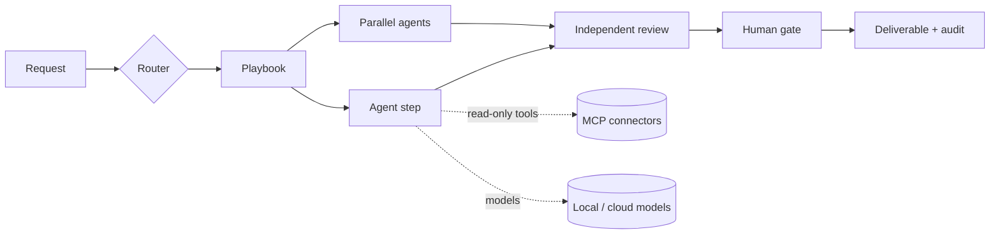

# Agentic Productivity Suite

A platform-agnostic application that turns a library of specialist agents into governed, repeatable workflows for professionals: daily planning, decisions, management, product development, engineering and investment cases.

Two front doors. **Chat** with the Chief of Staff, who answers or brings in up to three specialists, or with any single agent, for anything. Or route a request to a **playbook**: a fixed sequence of steps in which specialist agents work in order or in parallel. A different agent reviews the work, and anything that would leave the app waits for a named person. Agents can run on local models (Ollama, LM Studio, vLLM), OpenAI-compatible clouds (OpenAI, DeepSeek, OpenRouter) and Anthropic, mixed in one run. They read live context through read-only MCP connectors (GitHub, Microsoft 365, Databricks, Azure DevOps, Jira/Confluence, local files).

> Status: MVP. 19 playbooks (PB-00 to PB-18) and direct chat, with 34 agents in 8 desks. Everything day to day is set up in the app's Settings. Runs in the browser, as a desktop app, and fully offline with local models. See [docs/SAFETY.md](docs/SAFETY.md) for the risk controls and [docs/adr/](docs/adr/) for the design decisions.

## Quick start

Requirements: Python 3.12+ with [uv](https://docs.astral.sh/uv/), Node 20+. Docker or `npx` only if you enable connectors that use them.

```bash
./scripts/dev.sh
```

Then open http://127.0.0.1:8765. Windows (`.msi`) and Linux (`.deb`) installers are built by GitHub Actions; see [docs/DESKTOP.md](docs/DESKTOP.md) for downloads, offline use and phones. The suite needs at least one model: until one is switched on, agent steps stop as BLOCKED with "No model configured" (deterministic calculators still run). Set one up in Settings (below).

For UI development with hot reload:

```bash
cd backend && uv sync && uv run uvicorn app.main:app --port 8765
```

```bash
cd frontend && npm install && npm run dev
```

## Configure models

**From the app (simplest):** Settings → Model providers. Each provider has an **On/Off** switch and an **Edit** panel for its address, API key and models (**Find models** asks the server which models it has). Changes are saved on this computer and apply immediately; **Reset to file defaults** undoes them. A provider switched on here is also used as a fallback by every tier. For LM Studio, start the server, load a model, and if you switched on its authentication, paste its API key in Edit.

**From files:** copy `config/suite.example.yaml` to `config/suite.yaml` (the desktop app uses `~/.productivity-suite/suite.yaml`); it sets the defaults the app starts from. Files never hold credentials: each provider names an environment variable. A key typed into the app is stored unencrypted in the suite's local database and never returned by the API; prefer environment variables for cloud keys.

| Provider | Where | Enable |
|---|---|---|
| Ollama | local | Switch on (or `enabled: true`). Set Ollama's context length (`OLLAMA_CONTEXT_LENGTH` or `num_ctx`) and match the model's context in Edit. |
| LM Studio, vLLM | local | Switch on, then Edit → Find models and pick the loaded model. Add the API key if the server requires one. |
| OpenAI, DeepSeek, OpenRouter | cloud | Edit → API key, or export `OPENAI_API_KEY`, `DEEPSEEK_API_KEY` or `OPENROUTER_API_KEY`. Add the models you use. |
| Anthropic | cloud | Edit → API key, or export `ANTHROPIC_API_KEY`. |

Each **tier** (`router`, `specialist`, `synthesis`, `review`) is an ordered fallback chain. The first model that is available *and* allowed for the run's data class is used. If it errors or declines, the next one is tried. Change the order in Settings → Models → Fallback order. **Online**, each agent can use its own model (Agents → pick an agent → Model for this agent); its tier chain stays as the fallback. **Offline**, one local model goes first for every agent (Settings → Models → Model for every agent when offline, or automatic). Per-step choices (`models:` in a playbook) stay in the playbook files.

**Offline mode** pauses every cloud provider and every connector that needs the internet in one step, without changing your per-provider choices; going online restores them. Toggle it from the top bar or Settings; the choice persists. The default can also come from `offline: true` or `SUITE_OFFLINE=1`.

**Model endpoints from the app.** Settings → Model endpoints connects to any OpenAI-compatible server without editing files, such as a small model served from a phone or a laptop on your network. Enter the address, pick a model, choose tiers. Addresses on your own network count as local; others count as cloud.

**Data classes.** Each run is tagged `public`, `internal`, `confidential` or `restricted`, and Settings → Policies & budgets decides which classes may reach cloud models. `restricted` always stays on local models. You are responsible for the credentials and data you use; this policy is how you keep sensitive work local.

Settings → Model providers shows each provider's state and has a **Test** button once it is ready. When **Find models** fails, the message says why: a 401 means the server wants an API key, a 404 usually means the address should end in `/v1`, and "could not reach" means nothing is listening there.

## Connectors (MCP, read-only)

Set them up in Settings → Connectors: switch one on, open **Edit**, fill in what it needs (tokens are write-only), and **Test**. **Local files** is built in: choose one or more folders and agents can list, search and read files there (including PDF, Word and Excel), offline too, with nothing else to install. Setup notes and what to verify are in [docs/CONNECTORS.md](docs/CONNECTORS.md).

**Read-only is enforced by the suite, not only by the server.** An agent is offered a tool only if it is allow-listed, declares `read_only_hint`, or is named like a query (`get_`, `list_`, `search_` and similar) with no write verb. Everything else is hidden and refused, and every call is audited.

## Playbooks

| Code | Playbook | Pattern |
|---|---|---|
| PB-00 | Ask the Chief of Staff | single agent |
| PB-01 | Daily Plan & Priorities | pipeline |
| PB-03 | Pressure-Tested Decision Brief | fan-out → independent challenge → memo |
| PB-04 | Audience Status Update | pipeline + evidence check + human gate |
| PB-05 | Scope-Change Triage | fan-out → synthesis → review (revise on fail) → gate |
| PB-08 | Opportunity to PRD and Feature Slices | pipeline + fan-out + review |
| PB-10 | Architecture Review & ADR | options → security/ops/QA reviews → ADR → review → gate |
| PB-13 | Investment Case | fan-out → synthesis → review → gate |
| PB-02 | Meeting Prep & Debrief | context → brief or debrief → review |
| PB-06 | Program Risk Review | schedule ∥ cost of delay ∥ stakeholder signals → register → review → gate |
| PB-07 | Idea to Validated Opportunity | framing → value ∥ feasibility → experiments → review |
| PB-09 | AI Opportunity to Governed Agent | opportunity → design → evaluation ∥ threat model → blueprint → review → gate |
| PB-11 | Spec to Engineering Delivery Plan | slices → backend ∥ frontend ∥ QA ∥ release → plan → review → gate |
| PB-12 | Data Product Design | design → contracts ∥ semantics → spec → data review → gate |
| PB-14 | Market Growth Thesis | market ∥ strategy → thesis → review (uses only data you provide) |
| PB-15 | Well Plan Review (safety-critical) | deterministic calculators → engineering review → NPT ∥ field challenge → review → engineer sign-off |
| PB-16 | NPT Event Review (safety-critical) | timeline and precursors → field view → actions → review → engineer sign-off |
| PB-17 | Training & Agent Blueprint | optional agent blueprint → training design → review |
| PB-18 | Invention Disclosure Check | disclosure → prior art and novelty → review → hand-off gate (not legal advice) |

Playbooks are YAML in `playbooks/`; the schema is in `backend/app/playbooks.py`. They are validated at startup, and a reviewer can never review its own agent's work.

## How it works



- **Agents.** `registry/catalog.yaml` is the public agent catalog: name, desk, summary, capabilities, skills, tools and modes. Each agent's full instructions, persona and lineage are a **private layer** that is not in this repository or in the installers. The app loads it at runtime from the first folder found: `SUITE_PRIVATE_REGISTRY`, `private_registry` in `config/suite.yaml`, `<data_dir>/private-registry`, then `./private-registry` (git-ignored). The desktop app looks in `~/.productivity-suite/private-registry`. Without it, the app still runs and each agent works from its public capability summary; Settings shows a warning. The Agents page shows only the capability summary; instructions, persona and lineage are never sent to the UI. See ADR 0005.
- **Contract.** Every agent returns Markdown plus a JSON handoff: status, claims labelled FACT / ASSUMPTION / INFERENCE with traces, risks, open questions and next action. A FACT without a trace is downgraded to ASSUMPTION.
- **Guardrails.** Pasted text, files and tool results are wrapped as untrusted data and screened for injection attempts. The suite has no send/write/publish capability. Deliverables are screened for language that evaluates people. Runs have cost and token budgets, a per-step tool-call limit and a global kill switch. The audit log redacts secrets.
- **Deterministic tools.** The well-planning calculators (casing, hydraulics, torque and drag, risk matrix) run as tested Python functions, so a model never produces those numbers. In Well Plan Review they run first from the JSON you enter, and the engineering agent must cite their results. Output is marked planning-grade and needs a qualified engineer's sign-off.

## Tests and evals

```bash
cd backend && uv run pytest
```

```bash
cd backend && uv run python ../scripts/run_evals.py
```

The first runs 91 tests: engine, every playbook end to end, chat and delegation, settings made in the app, providers (mocked HTTP), MCP (including the built-in Local files), API, guards, calculators and registry. The second runs `evals/cases.yaml` against your configured models and writes a report with a column for your grade.

## Project layout

```
backend/app/        engine, providers, connectors, prompts, guards, store, API
backend/tests/      pytest suite (no network or model needed)
frontend/           React UI (built into frontend/dist, served by the backend)
desktop/            desktop launcher and PyInstaller spec
registry/           compiled agents, skills, desks (generated; do not edit by hand)
playbooks/          workflow definitions
config/             example config, output policies, profile
evals/              benchmark cases
scripts/            ingest, evals, dev server
docs/               plan, connector setup, ADRs
```

## Security notes

- The server binds to `127.0.0.1`. If you expose it, set `SUITE_API_TOKEN`; every API call then needs `Authorization: Bearer <token>`.
- Prompts are not stored by default (`store_prompts: false` keeps only a hash and size).
- Company branding is not in the repository. To theme exports privately, set `theme_dir` to a folder containing `theme.css`.

## License

Apache License 2.0. See [LICENSE](LICENSE) and [NOTICE](NOTICE), which also lists the third-party components bundled in the installers. Code signing for the Windows installer is described in [docs/CODE_SIGNING.md](docs/CODE_SIGNING.md).
